# Статическое обнаружение вредоносных Windows PE-файлов

## Аннотация

В работе исследуется бинарный детектор исполняемых файлов Windows. По содержимому файла он оценивает, насколько тот похож на вредоносные образцы. Проверка состояла из двух частей. Первая показывала, как модель распознаёт более поздние файлы из источника обучения SOREL-20M. Вторая проверяла перенос на отдельно собранную коллекцию gold.

Рабочая модель — LightGBM на 600 деревьях, обученный на 100 000 стратифицированных файлах с 2 192 признаками. При пороге 0,5 она правильно классифицировала все обучающие файлы. На тесте SOREL обнаружила 6 090 из 6 346 вредоносных файлов при 113 ложных тревогах, на gold — 20 из 128 при трёх ложных тревогах. В отдельном опыте на 400 деревьях исключение заголовка PE дало 33 обнаружения на gold при двух ложных тревогах. Этот вариант сохранён кандидатом для независимой проверки.

## 1. Задача и критерии оценки

Детектор получает один PE-файл (Portable Executable, например EXE или DLL). Положительный класс означает, что файл размечен как вредоносный, отрицательный — как легитимный. Анализ статический: байты читаются без исполнения программы. Для обучения нужны файлы с известными метками. Для применения готовой модели достаточно извлечь признаки в том же порядке, что при обучении.

Практическая задача содержит две разные ошибки. Пропуск вредоносного файла обозначается FN, а ложная тревога на легитимном — FP. Если помечать вредоносными почти все файлы, можно обнаружить большинство угроз и одновременно заблокировать большую часть легитимных программ. Поэтому в отчёте для одного и того же набора приведены оба числа.

| Показатель | Как его читать |
|---|---|
| TP, TN | Количество правильно распознанных вредоносных и легитимных файлов соответственно. |
| Recall, FNR | Среди вредоносных файлов recall = TP / (TP + FN) обнаружено, FNR = FN / (TP + FN) пропущено. |
| FPR, precision | FPR = FP / (FP + TN) измеряет долю тревог среди легитимных. Precision = TP / (TP + FP) измеряет долю действительно вредоносных среди всех тревог. |
| Accuracy, F1 | Accuracy — доля верных ответов во всей выборке. F1 — гармоническое среднее precision и recall. |
| ROC-AUC, AP | ROC-AUC оценивает ранжирование пар файлов разных классов. Average precision (AP) суммирует precision при увеличении recall. AP зависит от доли положительного класса. |
| Brier, log loss | Brier усредняет квадрат разности между оценкой и меткой 0 или 1. Log loss сильнее штрафует уверенные ошибки. Для обеих метрик меньшее значение лучше. |

В первых опытах пороги выбирались по SOREL validation. На следующем этапе по условию исследования введено единое правило: исходная оценка **≥ 0,5** даёт класс 1. Все сравнения начиная с раздела 5 используют это правило. Валидационная выборка используется для выбора параметров и изучения калибровки, тестовая — для измерения качества.

## 2. Данные, происхождение меток и защита от пересечений

**SOREL-20M.** Причиной выбора набора стали готовые числовые признаки статического анализа, метки вредоносности, идентификаторы SHA-256 и время наблюдения. Это позволило обучать модели на одном представлении и разделять примеры по времени. По подготовленным манифестам старые объекты попали в train, следующие по времени — в validation, самые поздние — в test. Полные размеры периодов и фактический объём отдельных экспериментов различаются.

| Период SOREL | Легитимных | Вредоносных | Всего записей |
|---|---:|---:|---:|
| Обучение | 5 269 731 | 7 639 024 | 12 908 755 |
| Валидация | 1 581 886 | 962 900 | 2 544 786 |
| Тест | 2 910 560 | 1 360 896 | 4 271 456 |

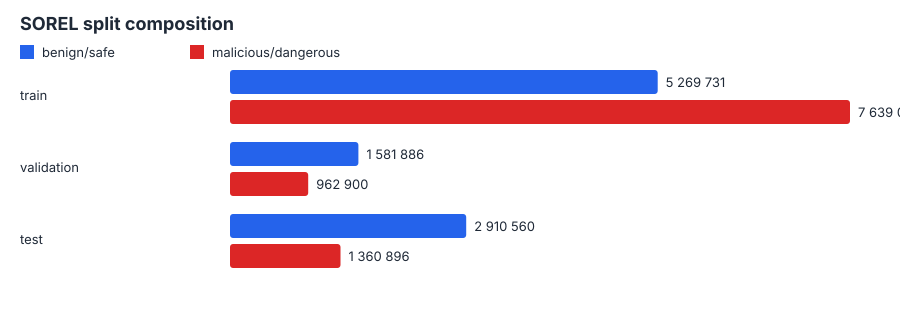

**Внешняя коллекция gold.** Вредоносные PE происходят из MalwareBazaar, легитимные — из пакетов, найденных по манифестам Microsoft WinGet, и с официального сайта PuTTY. Для записей сохраняли исходный SHA-256, метку, источник и доступные метаданные. Образцы MalwareBazaar хранились в защищённых паролем архивах с нейтральным расширением. Для статического анализа содержимое читалось в память. У легитимных исполняемых файлов также менялось расширение.

Из 3 215 исходных объектов исключили один легитимный файл, SHA-256 которого совпал с записью SOREL. Точных повторов внутри gold не нашли. Осталось **3 214 объектов: 2 477 вредоносных и 737 легитимных** (732 WinGet и 5 PuTTY). Проверка хешей выявляет полные копии. Близкие сборки с разными хешами могли сохраниться: побайтовая дедупликация между корпусами не проводилась.

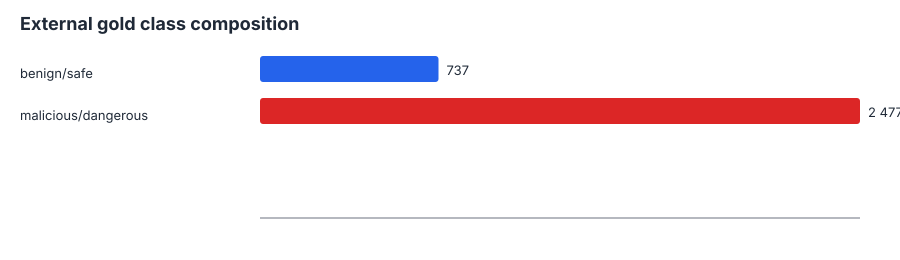

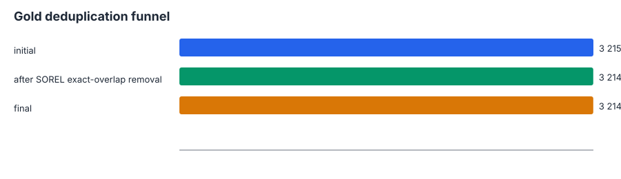

Для раннего прогона брали всю коллекцию из 3 214 записей. Для последующих повторных экспериментов один раз отобрали **панель из 256 файлов**, по 128 каждого класса, с seed 42. Все 256 удалось обработать. В ней 127 легитимных файлов из WinGet и один из PuTTY. Состав панели и SHA сохранялись между экспериментами. Значения precision и AP на полной коллекции и на сбалансированной панели относятся к разным пропорциям классов.

## 3. Извлечение и отбор признаков

Для SOREL векторы загружались из LMDB. Для gold локальный экстрактор получал вектор из байтов PE. После проверки формата вычисляли признаки схемы EMBER v2, применяли поэлементное преобразование `sign(x) × log(1 + |x|)` и выбирали сохранённые индексы. Преобразование сжимает большой диапазон чисел и сохраняет знак. Имя файла, путь, URL, SHA-256 и название источника не подавались на вход модели.

| Группа EMBER | Исходных координат | Осталось |
| --- | ---: | ---: |
| Распределение байтов | 256 | 256 |
| Энтропия байтов | 256 | 238 |
| Статистики строк | 104 | 104 |
| Общие свойства файла | 10 | 8 |
| Заголовок PE | 62 | 37 |
| Секции | 255 | 128 |
| Импорты | 1280 | 1274 |
| Экспорты | 128 | 128 |
| Каталоги данных | 30 | 19 |
| **Всего** | **2 381** | **2 192** |

Отбор выполнен на отдельной выборке обучающего периода из 50 000 объектов каждого класса. Удалили 45 постоянных координат, 24 с долей нулей не менее 99,9%, ещё 39 с долей нулей не менее 99,5% и 81 из сильно коррелирующих координат (модуль корреляции Пирсона от 0,95). При выборе представителя коррелирующей пары учитывались связь с меткой и разреженность. Всего исключено 189 координат. Порядок оставшихся 2 192 колонок одинаков при обучении и проверке.

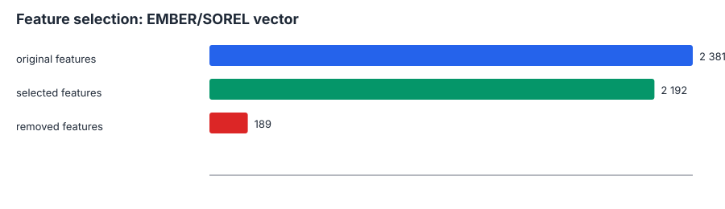

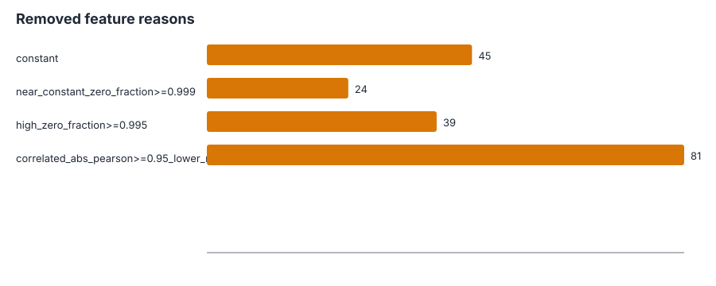

## 4. Первоначальный цикл экспериментов на полном обучающем периоде

### 4.1. Линейная модель и пять проходов по данным

Первой моделью стал линейный классификатор с логистической функцией потерь. Каждый признак получает вес, взвешенная сумма преобразуется в оценку от 0 до 1. Веса обновлялись методом стохастического градиентного спуска (SGD) на небольших пакетах. Параметры стандартизации оценивались на train. Такой способ позволил читать большой набор по частям.

Сравнили одну и пять эпох, где эпоха означает проход по обучающим данным. В журнале пяти эпох зарегистрировано 63 495 065 обработанных строк с повторами, около 12,7 млн за проход. Для каждого варианта на валидации подбирали порог при ограничении FPR около 5%. Поэтому результат двух запусков отражает и обучение, и выбранную для него рабочую точку.

| Модель | Набор | Порог | Accuracy, % | Precision, % | Recall, % | F1, % | FPR, % | FNR, % |
| --- | ---: | ---: | ---: | ---: | ---: | ---: | ---: | ---: |
| SGD, 1 эпоха | SOREL validation | 0,973665 | 93,40 | 91,74 | 90,76 | 91,25 | 4,99 | 9,24 |
| SGD, 1 эпоха | SOREL test | 0,973665 | 93,36 | 89,55 | 89,93 | 89,74 | 5,01 | 10,07 |
| SGD, 1 эпоха | Gold | 0,973665 | 86,73 | 89,69 | 93,53 | 91,57 | 36,09 | 6,47 |
| SGD, 5 эпох | SOREL validation | 0,651559 | 93,85 | 91,86 | 91,92 | 91,89 | 4,97 | 8,08 |
| SGD, 5 эпох | SOREL test | 0,651559 | 94,35 | 91,01 | 91,57 | 91,29 | 4,32 | 8,43 |
| SGD, 5 эпох | Gold | 0,651559 | 88,19 | 90,08 | 95,15 | 92,55 | 35,14 | 4,85 |

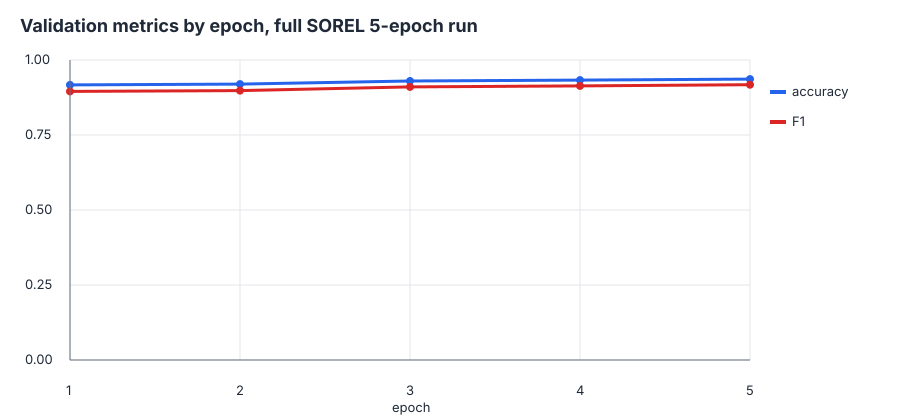

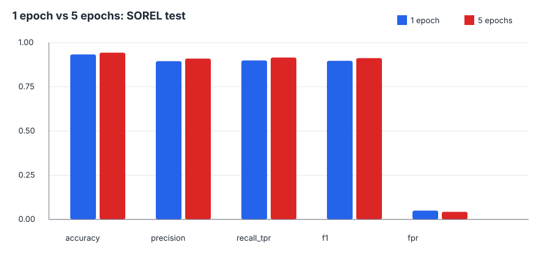

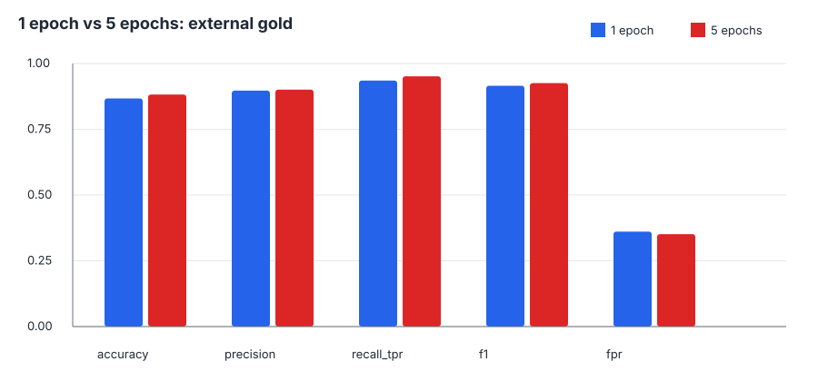

Для SGD после пяти эпох при пороге 0,5 на SOREL validation получены recall 93,61% и FPR 6,34%. При выбранном в то время пороге 0,651559 они составили 91,92% и 4,97%. При более строгом пороге 0,989547 recall упал до 74,79%, FPR — до 0,99%. Изменение порога меняло решение уже обученного классификатора.

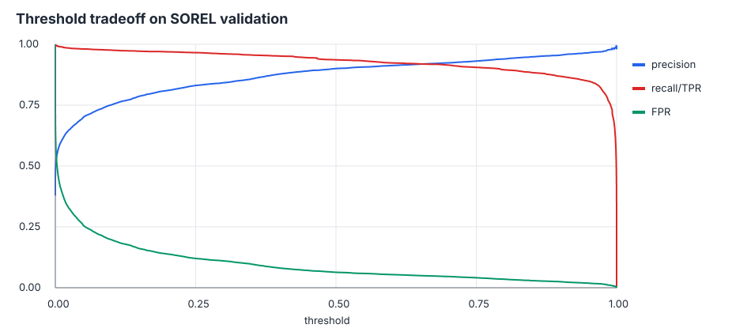

### 4.2. Первый LightGBM и проверка на внешних файлах

Вторым алгоритмом стал градиентный бустинг LightGBM. Каждое новое дерево вносит поправку с учётом ошибок предыдущих. В исходном большом прогоне обучение продолжалось по частям данных. После пятой эпохи сохранён ансамбль из 970 деревьев. Его рабочий порог по SOREL validation составил 0,122344. Таблица показывает показатели двух моделей при их исторических порогах. Метрики выражены в процентах.

| Модель | Набор | Порог | Accuracy | Precision | Recall | F1 | ROC-AUC | AP | FPR | FNR |
| --- | ---: | ---: | ---: | ---: | ---: | ---: | ---: | ---: | ---: | ---: |
| SGD, 5 эпох | SOREL validation | 0,651559 | 93,85 | 91,86 | 91,92 | 91,89 | 97,88 | 96,84 | 4,97 | 8,08 |
| SGD, 5 эпох | SOREL test | 0,651559 | 94,35 | 91,01 | 91,57 | 91,29 | 97,80 | 96,28 | 4,32 | 8,43 |
| SGD, 5 эпох | Gold | 0,651559 | 88,19 | 90,08 | 95,15 | 92,55 | 86,91 | 94,80 | 35,14 | 4,85 |
| LightGBM, 970 деревьев | SOREL validation | 0,122344 | 96,67 | 92,57 | 99,32 | 95,83 | 99,85 | 99,81 | 5,00 | 0,68 |
| LightGBM, 970 деревьев | SOREL test | 0,122344 | 96,50 | 91,31 | 98,61 | 94,82 | 99,75 | 99,60 | 4,51 | 1,39 |
| LightGBM, 970 деревьев | Gold | 0,122344 | 54,69 | 97,93 | 42,09 | 58,88 | 90,86 | 96,77 | 2,99 | 57,91 |

В исторических журналах SOREL у SGD оценены 19 622 строки валидации и 19 639 строк теста, у LightGBM — 2 495 801 и 4 195 063 соответственно. Поэтому первые строки таблицы дают результаты каждого запуска на его объёме данных. Сравнение на одинаковых файлах приведено ниже.

На gold у SGD успешно оценены 3 210 файлов из 3 214. У LightGBM оценены 3 209: в четырёх случаях после чтения вход не прошёл проверку PE, один файл превысил лимит времени. Метрики вычислялись по успешно обработанным файлам. Для SGD на gold было 478 TN, 259 FP, 120 FN и 2 353 TP. У LightGBM — 714 TN, 22 FP, 1 432 FN и 1 041 TP. Линейная модель обнаруживала большую часть вредоносных файлов ценой частых тревог на легитимные. Например, тревога возникла на всех 92 файлах с тегом Inno и на всех 87 с тегом Nullsoft в разобранных группах раннего прогона.

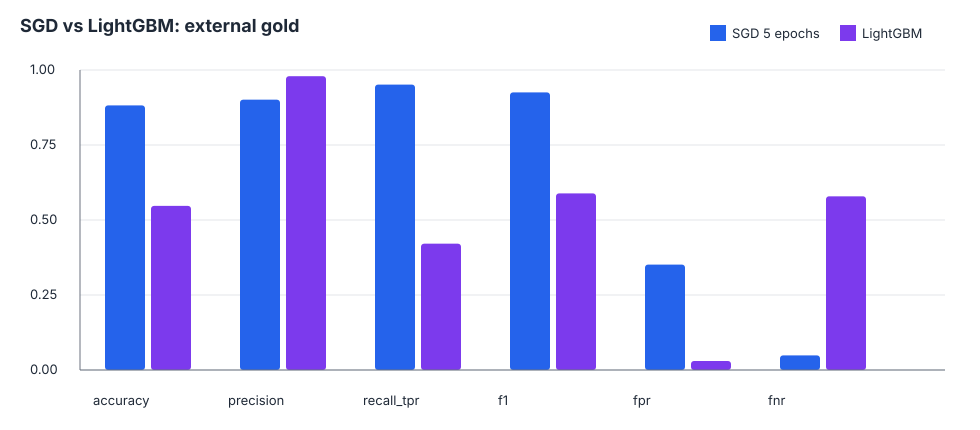

### 4.3. Почему изменили протокол

В ранней диагностике на сохранённых внешних оценках LightGBM проверили чувствительность результата к порогу. На одних и тех же 3 209 файлах получились следующие рабочие точки.

| Историческое правило | Порог | TP | FN | FP | TN | Recall | FPR |
|---|---:|---:|---:|---:|---:|---:|---:|
| Порог, выбранный на SOREL | 0,122344 | 1 041 | 1 432 | 22 | 714 | 42,09% | 2,99% |
| Диагностика gold при FPR до 20% | 0,013284 | 2 118 | 355 | 147 | 589 | 85,64% | 19,97% |
| Диагностика gold при recall от 95% | 0,004806 | 2 352 | 121 | 257 | 479 | 95,11% | 34,92% |

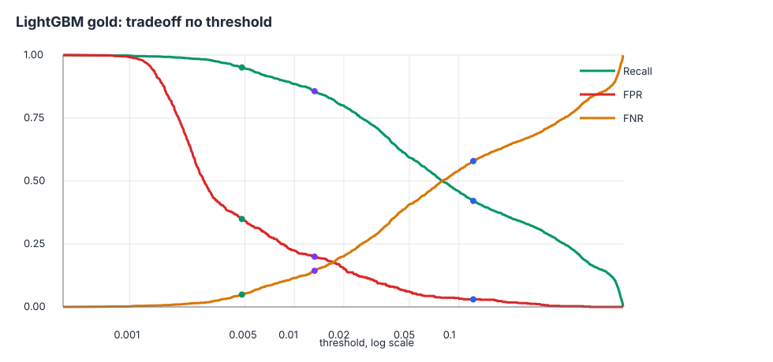

Последние две строки получены после просмотра gold. Их можно использовать для объяснения поведения оценок. Для доказательства улучшения на новых файлах нужна другая проверка. В дальнейшем порог зафиксировали на 0,5, а изменяли состав обучения, настройки модели или признаки. Первоначальный gold, включая файлы за пределами панели из 256 объектов, с этого момента служит изученной диагностической коллекцией.

### 4.4. Пересчёт ранних моделей при едином правиле

Чтобы сопоставить результаты на одних и тех же файлах, для двух исторических моделей пересчитали решения по порогу 0,5. На SOREL обе модели применили к одним 19 639 векторам. На gold взяли пересечение по SHA-256 и метке среди успешных прогнозов обоих запусков. Веса моделей сохранились.

| Файлы | Историческая модель | TN | FP | FN | TP | Recall | FPR |
|---|---|---:|---:|---:|---:|---:|---:|
| SOREL test, 19 639 | SGD, 5 эпох | 12 537 | 756 | 431 | 5 915 | 93,21% | 5,69% |
| SOREL test, 19 639 | LightGBM, 970 деревьев | 13 219 | 74 | 229 | 6 117 | 96,39% | 0,56% |
| Gold, 3 209 | SGD, 5 эпох | 473 | 263 | 98 | 2 375 | 96,04% | 35,73% |
| Gold, 3 209 | LightGBM, 970 деревьев | 734 | 2 | 1 917 | 556 | 22,48% | 0,27% |

На сопоставимом SOREL test бустинг уменьшил и FP, и FN. На gold его низкий FPR сопровождался пропуском 1 917 из 2 473 вредоносных объектов. Именно этот разрыв стал отправной точкой опытов с составом обучающей выборки, другими бустингами и представлением признаков.

## 5. Стратификация и воспроизводимое сравнение моделей

Полное обучение требовало многочасовых прогонов. Для быстрых контролируемых опытов выбрали 100 тыс. доступных в LMDB файлов обучающего периода. Сначала формировали пул по случайным префиксам SHA, набирая как минимум удвоенный целевой объём. Из одного пула строили два варианта train: обычную случайную выборку и выборку с квотами по сочетанию класса и календарного месяца. Месяц здесь характеризует время наблюдения файла. Квоты сохраняют долю старых и более поздних файлов каждого класса при уменьшении выборки. Выигрыш во времени даёт уменьшение числа строк. Стратификация контролирует, какие строки останутся.

В основной стратифицированной выборке seed 42 было 59 908 вредоносных и 40 092 легитимных PE за январь 2017 — ноябрь 2018 года. При обучении веса обратно пропорциональны численности класса. На проверке каждое наблюдение учитывается один раз. Из первых 20 000 строк тестового манифеста доступны векторы 19 639 файлов, в том числе 6 346 вредоносных и 13 293 легитимных. Для 361 файла запись в LMDB отсутствовала. Первые 10 тыс. строк валидационного манифеста зарезервированы для калибровки, следующие 10 тыс. — для сравнения параметров (9 815 доступных векторов).

### 5.1. Как выбирали основной алгоритм

Для линейной модели на одинаковых 100 тыс. стратифицированных строк использовали пять проходов, батчи по 2 048 и L2-регуляризацию с коэффициентом 0,00001. У двух бустингов в первом сравнении было по 100 деревьев, шаг 0,08 и четыре потока. LightGBM строил до 63 листьев с минимумом 100 объектов в листе. CatBoost использовал симметричные деревья глубины 6 и L2-регуляризацию листьев 3. Дерево позволяет учитывать сочетания признаков, например различное значение размера секции в двух типах PE. У линейной модели каждая координата имеет постоянный вес.

| Модель и отбор | SOREL test AP | SOREL FN | SOREL FP | Gold FN | Gold FP | Обучение бустинга, с |
|---|---:|---:|---:|---:|---:|---:|
| SGD, стратифицированный | 0,8489 | 713 | 983 | 6 | 112 | — |
| CatBoost, стратифицированный | 0,9827 | 429 | 455 | 114 | 2 | 23,0 |
| LightGBM, стратифицированный | 0,9926 | 356 | 151 | 114 | 2 | 15,2 |
| LightGBM, случайный | 0,9929 | 317 | 170 | 107 | 3 | 14,4 |

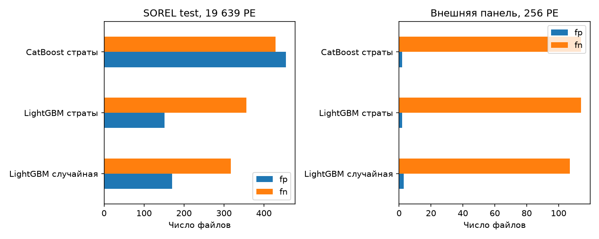

При одинаковом стратифицированном train LightGBM дал на SOREL на 73 пропуска и 304 ложные тревоги меньше, чем CatBoost, и быстрее обучался на готовой матрице. Преимущество по обоим видам ошибок на SOREL сохранилось при повторном отборе train. На gold первоначальные бустинги дали одинаковое количество ошибок, а SGD пометил вредоносными 234 файла из 256. **LightGBM выбран как рабочий алгоритм курсовой** по сочетанию качества внутри SOREL, времени повторных опытов и возможности вычислять точные вклады деревьев с TreeSHAP. Превосходство над CatBoost на независимом современном источнике остаётся открытым вопросом.

### 5.2. Размер выборки, месячные квоты и обучение по частям

| Seed отбора | Случайный LightGBM, FN / FP | Стратифицированный LightGBM, FN / FP | Стратифицированный CatBoost, FN / FP |
| --- | ---: | ---: | ---: |
| 42 | 317 / 170 | 356 / 151 | 429 / 455 |
| 43 | 349 / 143 | 332 / 136 | 425 / 419 |
| 44 | 327 / 147 | 331 / 168 | 412 / 448 |

При seed 42 стратификация уменьшила количество ложных тревог LightGBM на 19 и увеличила число пропусков на 39. При seed 43 уменьшились оба показателя. Это объясняет, почему один выигрышный запуск не служит доказательством, что квоты сами по себе улучшают детектор. На внешней панели при seed 42 разница recall между стратифицированным и случайным отбором составила −5,47 процентного пункта. Интервал при попарной повторной выборке 128 вредоносных файлов, 10 тыс. повторов, составил от −10,94 до −0,78 пункта. Родство файлов внутри семейства ограничивает интерпретацию интервала.

На вложенной выборке из 30 тыс. строк стратифицированный LightGBM обучался 5,7 с против 15,2 с на 100 тыс. При увеличении объёма AP на тесте выросла с 0,9919 до 0,9926, количество FP сократилось с 222 до 151, а FN увеличилось с 309 до 356. Отдельно повторили ранний способ обучения на этих же 100 тыс. файлов, добавляя по 25 деревьев на каждую из четырёх частей. Получили 337 FN и 205 FP. Поэтапная подача разных частей train и обучение ансамбля на единой матрице дают разные решения даже при одинаковом числе деревьев.

## 6. Параметры обучения и число деревьев

Сначала меняли по одному параметру на отдельном блоке validation. Время в таблице включает обучение и получение оценок для этого опыта. AP показывает качество ранжирования на одном составе файлов.

| Алгоритм | Настройки относительно исходных | AP на validation | Время, с |
| --- | ---: | ---: | ---: |
| lightgbm | 63 листа, минимум 100 объектов, шаг 0,08 | 0,9955 | 15,7 |
| lightgbm | 31 лист | 0,9923 | 9,2 |
| lightgbm | Минимум 300 объектов в листе | 0,9952 | 12,9 |
| lightgbm | Шаг 0,03 | 0,9891 | 13,8 |
| catboost | Глубина 6, L2 = 3 | 0,9846 | 22,0 |
| catboost | Глубина 8 | 0,9903 | 30,1 |
| catboost | L2 = 8 | 0,9838 | 22,5 |

Уменьшение шага при фиксированных 100 деревьях снизило AP LightGBM. Модель делает меньшие поправки и за то же количество шагов может не успеть выучить полезные зависимости. У CatBoost увеличение глубины с 6 до 8 добавило около 0,006 к AP и увеличило время опыта примерно на восемь секунд. Эти измерения относятся к проверенным настройкам.

Затем обучили LightGBM на том же train до 1 000 деревьев и проверили предсказания после заранее выбранных итераций. Поскольку деревья добавляются последовательно, первые 400 деревьев длинного ансамбля можно проверить отдельно. Кандидата выбирали по максимальной AP на validation до оценки его на test и gold.

| Деревьев | Train, FN / FP | Validation, FN / FP | Validation AP |
| --- | ---: | ---: | ---: |
| 100 | 1622 / 430 | 137 / 85 | 0,995510 |
| 200 | 626 / 67 | 95 / 71 | 0,997128 |
| 400 | 14 / 1 | 78 / 67 | 0,997735 |
| 600 | 0 / 0 | 71 / 66 | 0,997946 |
| 1000 | 0 / 0 | 69 / 65 | 0,998128 |

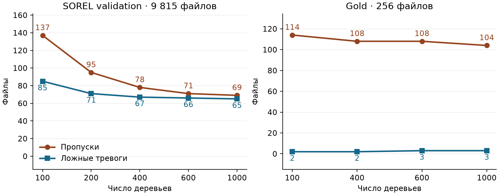

На SOREL test при переходе от 100 к 400 деревьям FN сократились с 356 до 270, FP — со 151 до 117. Доля пропусков 5,61% исходной модели относится к **тесту**. На train при 100 деревьях она составляла 2,71%. При 600 деревьях на train уже не осталось ошибок при пороге 0,5. Дополнительные деревья продолжали менять уверенность модели, и при 1 000 деревьев на validation стало ещё на два пропуска меньше.

При 1 000 деревьев на SOREL test получено 245 FN и 109 FP. На gold обнаружено 24 из 128 при трёх ложных тревогах против 20 при двух у версии на 400 деревьях. В демонстрации закреплена конфигурация на 600 деревьях. В отдельном прогоне она дала 256 FN и 113 FP на SOREL test, 108 FN и 3 FP на gold. По AP на validation среди пяти проверенных вариантов лидирует 1 000. Ранняя остановка в этих опытах не применялась. Для такого опыта требуются отдельные данные валидации при обучении, метрика и правило ожидания улучшения.

## 7. Калибровка оценок

Чтобы понять смысл выдаваемых чисел, файлы объединяли по диапазонам оценки и сравнивали среднюю оценку в диапазоне с фактической долей вредоносных. При хорошей калибровке среди файлов с оценкой около 0,8 примерно восемь из десяти должны иметь положительную метку. Для поправки вероятностей на выделенном блоке validation обучали логистическое преобразование исходных логарифмов шансов. В таблице ниже качество вероятностей измерено на SOREL test. У обеих функций потерь меньшее значение предпочтительнее.

| Модель, деревьев | Brier до | Brier после | Log loss до | Log loss после |
| --- | ---: | ---: | ---: | ---: |
| LightGBM, 100 | 0,02049 | 0,01999 | 0,08028 | 0,07208 |
| CatBoost, 100 | 0,03841 | 0,03228 | 0,15222 | 0,11521 |
| LightGBM, 400 | 0,01526 | 0,01539 | 0,05708 | 0,05902 |

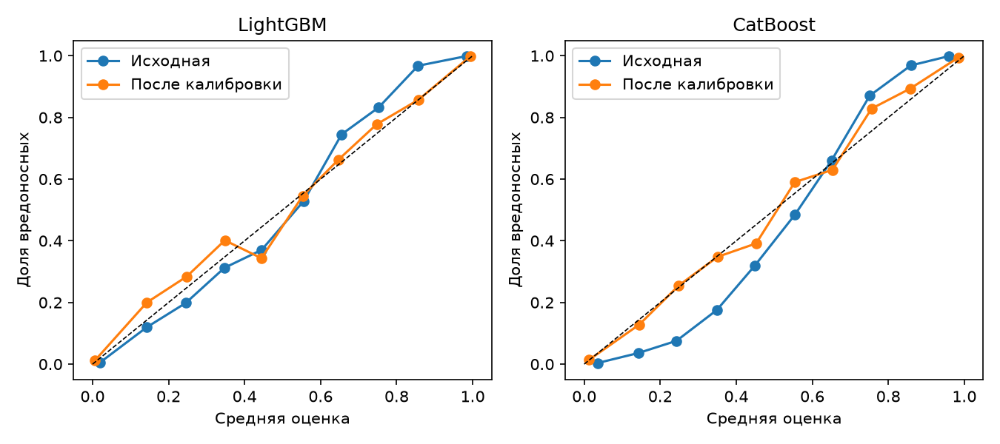

Для моделей на 100 деревьях обе потери уменьшились. Для LightGBM на 400 деревьях калибровка слегка ухудшила оба показателя. Поэтому переносить вывод раннего опыта на итоговую конфигурацию оснований нет. В таблицах ошибок использованы исходные оценки при пороге 0,5.

## 8. Какие свойства файла влияют на решение

TreeSHAP раскладывает исходную оценку дерева или ансамбля на базовое значение и вклады колонок. Сумма измеряется в логарифмах шансов (log-odds), затем переводится в вероятность. Положительный вклад повышает оценку вредоносности, отрицательный понижает. Нулевая итоговая сумма соответствует вероятности 0,5. Для разобранных файлов сумма вкладов и базы сверена с выходом модели до преобразования. Глобальная важность — средний модуль вклада; направление влияния видно в знаковых вкладах.

На gold у LightGBM со 100 деревьями среди ведущих глобальных признаков оказались временная метка COFF и размер таблицы сертификатов, со средними абсолютными вкладами 0,63 и 0,57. Для CatBoost самым большим оказался вклад размера таблицы сертификатов (0,56). Размер таблицы сам по себе не удостоверяет подлинность подписи. У пропущенного вредоносного примера LightGBM общая оценка была −0,333; две координаты заголовка дали −0,479 и −0,356, частично компенсированные другими вкладами.

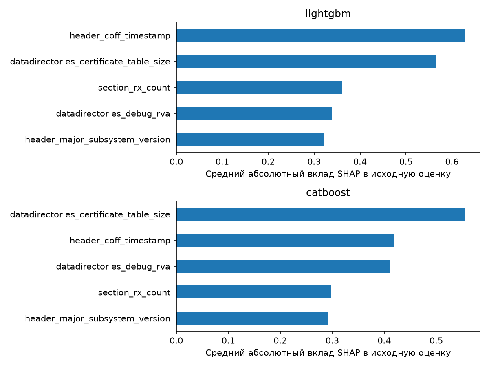

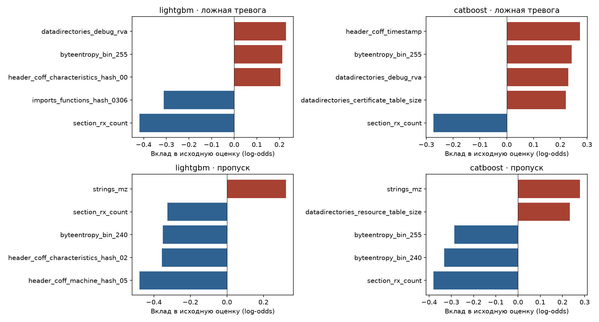

Для исходной модели на 400 деревьях средние абсолютные вклады времени COFF и размера таблицы сертификатов выросли до 1,08 и 0,86. Затем для каждого из 128 вредоносных файлов сложили **знаковые** вклады колонок одной группы EMBER и усреднили их отдельно среди 108 пропущенных и 20 обнаруженных.

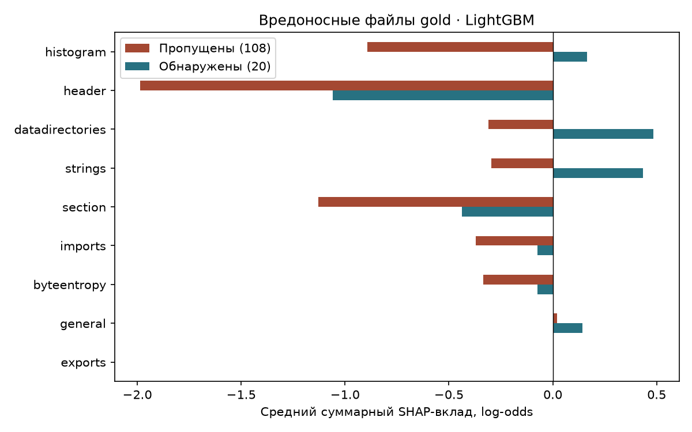

У пропущенных файлов заголовок PE дал самый большой средний отрицательный вклад (−1,99), у обнаруженных он тоже был отрицательным (−1,06). Наибольшая разница между группами наблюдалась у гистограммы байтов: −0,89 против +0,16. Общая средняя оценка составила −3,35 против +1,53. Такое разбиение по решению модели помогает установить, какие признаки внесли вклад в различие. Чтобы проверить, поможет ли их удаление, потребовалось переобучение.

## 9. Переобучение после удаления групп признаков

В первом опыте на 100 деревьях убрали выбранные колонки заголовка. Число пропусков на gold снизилось со 114 до 104 при тех же двух FP. На SOREL test FN снизились с 356 до 331, FP выросли со 151 до 199. Проверили и возврат всех 2 381 исходных признаков. На gold получились 112 FN и 4 FP. Простое расширение представления не восстановило внешнее качество.

Для модели на 400 деревьях каждый вариант обучили с нуля на тех же 100 тыс. файлов, с теми же весами и порогом. Вариант **«Без header»** исключает все 37 отобранных координат группы COFF и optional header. Остальные структурные признаки, включая секции и каталоги PE, сохраняются. Вариант **«Байты и строки»** исключает также явно извлекаемые структурные группы; его статистики вычисляются по всему содержимому файла, включая байты заголовков.

| Вход LightGBM | Признаков | Время fit, с | SOREL test FN | SOREL test FP | Gold TP из 128 | Gold FP из 128 | Gold F1 |
| --- | ---: | ---: | ---: | ---: | ---: | ---: | ---: |
| Исходные | 2192 | 38,8 | 270 | 117 | 20 | 2 | 0,2667 |
| Без header | 2155 | 37,2 | 248 | 143 | 33 | 2 | 0,4049 |
| Без гистограммы | 1936 | 18,3 | 268 | 107 | 20 | 2 | 0,2667 |
| Байты и строки | 598 | 25,5 | 411 | 392 | 20 | 4 | 0,2632 |

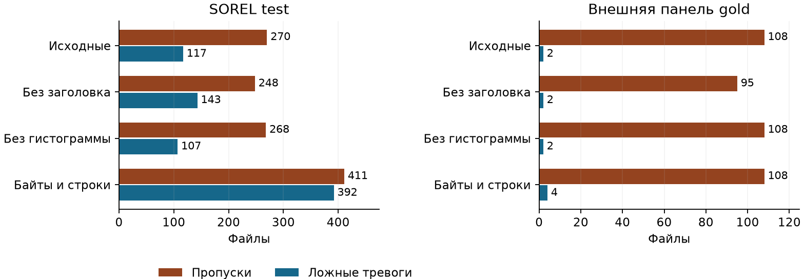

При исключении header доля обнаружений на gold выросла с 15,63% до 25,78%. Из прежних пропусков исправились 18, но ещё 5 ранее обнаруженных файлов стали пропусками. Две ложные тревоги пришлись на те же легитимные файлы. На SOREL test стало на 22 пропуска меньше и на 26 ложных тревог больше. Исключение гистограммы байтов не увеличило число обнаружений на gold, хотя у этой группы было самое большое различие на графике SHAP. У модели по байтам и строкам исправились 10 пропусков и появились 10 других, а FP выросли с двух до четырёх.

## 10. Какие объекты представлены в gold и где концентрируются ошибки

В полном gold у 2 419 из 2 477 вредоносных объектов заполнено поле `signature` MalwareBazaar. Встречается 45 названий семейств и инструментов. На пять самых частых приходится 2 263 файла. В проверочной панели 100 из 128 положительных файлов имеют одну из трёх сигнатур: CobaltStrike, AsyncRAT или Formbook. Публичное название инструмента и дата регистрации образца характеризуют разные вещи. У всех 128 вредоносных файлов даты регистрации лежат между сентябрём 2023 и ноябрём 2026 года, из них 88 зарегистрированы в 2026 году. Для легитимных файлов панели поле first_seen пусто.

| Сигнатура источника | В полном gold | В панели | Пропущено исходной | Пропущено без header |
| --- | ---: | ---: | ---: | ---: |
| CobaltStrike | 824 | 47 | 37 | 42 |
| AsyncRAT | 627 | 30 | 25 | 17 |
| Formbook | 419 | 23 | 20 | 16 |
| AgentTesla | 254 | 13 | 12 | 8 |
| RemcosRAT | 139 | 6 | 5 | 4 |
| HijackLoader, ParallaxRAT, VShell, WARDENStealer, XWorm | 43 | 5 | 5 | 5 |
| Без указанной сигнатуры | 58 | 4 | 4 | 3 |
| Другие сигнатуры только в полном gold | 113 | 0 | — | — |
| Всего | 2477 | 128 | 108 | 95 |

У модели без header сократилось число пропусков AsyncRAT, Formbook и AgentTesla, но увеличилось у CobaltStrike. Абсолютный выигрыш зависит от того, какие семейства преобладают в коллекции. Для пяти сигнатур в панели есть только по одному примеру, поэтому доля ошибок по каждой из них слишком чувствительна к одному решению.

Теги и поле signature также нельзя взаимозаменять. Например, в раннем разборе среди 30 файлов с *тегом* AsyncRAT стратифицированный LightGBM на 100 деревьях пропустил 27, CatBoost — 30. Для 23 файлов с тегом Formbook обе модели пропустили 20. Теги могут пересекаться. Таблица в этом разделе использует одно значение signature на файл и относится к моделям на 400 деревьях. В легитимной половине при 100 деревьях каждая из двух моделей дала по одной тревоге среди 15 установщиков с тегом Inno и 17 с тегом Nullsoft.

**Могли ли встречаться новые угрозы?** Публичный AsyncRAT появился в январе 2019 года, уже после последнего месяца нашей обучающей выборки. При этом обе модели обнаружили часть файлов с этой сигнатурой. Cobalt Strike существовал с 2012 года, Agent Tesla наблюдался с 2014-го, линия Formbook известна как минимум с 2016-го. Три эти названия дают 69 из 108 пропусков исходной модели и 66 из 95 пропусков варианта без header. Существование инструмента в эти годы ещё не доказывает присутствие конкретного семейства или его современной версии среди выбранных обучающих PE.

Для всех 59 908 вредоносных SHA train сверены поведенческие теги SOREL. Положительный тег spyware присутствует у 30 605 объектов, dropper — у 22 594, downloader — у 16 335. Теги пересекаются, у 2 341 объекта не было положительного значения ни по одному из 11 тегов. В локальной таблице SOREL отсутствует сопоставимое поле семейства. В тегах панели из 256 gold-файлов отсутствуют идентификаторы CVE. По этим данным можно исследовать перенос детектора вредоносных PE, но невозможно распределить все ошибки по уязвимостям или уверенно подсчитать долю впервые встреченных семейств.

## 11. Программная реализация и воспроизводимость

На первоначальном этапе созданы интерфейс Tkinter для проверки выбранного файла и пакетный расчёт по коллекции. Интерфейс позволял выбрать модель, открыть или перетащить файл и увидеть класс, оценку, порог и SHA-256. Пакетный режим записывал предсказания и ошибки обработки по отдельным файлам и мог продолжить прерванный проход. В раннем прогоне LightGBM использовались восемь параллельных обработчиков извлечения и лимит 10 секунд на файл. Это позволило учесть отдельно четыре неподходящих входа и одно превышение лимита.

После рефакторинга подготовка SOREL, извлечение признаков, обучение, внешняя проверка и интерфейс вынесены в соответствующие модули пакета. Единый класс бустинга создаёт LightGBM или CatBoost, метод `train` обучает созданную модель, методы проверки вычисляют метрики на SOREL и на внешней панели. Профиль задаёт размер train, seed и каталоги результатов. Для кандидатов с уменьшенным числом признаков сохранены веса и собственные упорядоченные списки индексов. Чтобы воспроизвести прогноз такого кандидата, необходимы оба файла.

Демонстрация использует готовый вектор легитимного PE и сохранённый LightGBM на 600 деревьях. В проверенном окружении macOS на Apple Silicon использованы Python 3.14.6, LightGBM 4.7.0, CatBoost 1.2.10, scikit-learn 1.9.1 и LIEF 1.0.0. На macOS для LightGBM требуется OpenMP. Команда `python -m pe_static_analyzer.prediction.demo` из корня проекта даёт `score=0.000066 class=0`. Для повторения исследовательских таблиц дополнительно требуются метаданные SOREL, LMDB с векторами, сохранённые манифесты или их воспроизводимый отбор и та же внешняя панель. Время fit приводится для готовой матрицы; чтение LMDB и разбор PE занимают дополнительное время.

## 12. Выводы и следующий эксперимент

1. **Модель.** На SOREL test при seed 42 LightGBM дал меньше FN и FP, чем обе контрольные модели. Преимущество над CatBoost по обоим видам ошибок сохранилось также при seed 43 и 44. Увеличение со 100 до 400 деревьев улучшило качество на отложенных данных. Даже 1 000 деревьев пропустили 104 из 128 вредоносных файлов gold.
2. **Данные.** Меньшая стратифицированная выборка сделала возможными быстрые повторные опыты. Направление изменения FN и FP при замене случайного отбора квотами зависит от состава выборки. Связь источника с меткой, время регистрации и концентрация нескольких семейств ограничивают перенос выводов на другие коллекции.
3. **Представление.** SHAP помог сформулировать проверяемую гипотезу. Удаление заголовка повысило внешнюю полноту с 15,63% до 25,78% на изученной панели. Исключение байтовой гистограммы такого выигрыша не дало. Отдельная проверка показала расхождение в кодировании части признаков при обучении и применении модели.
4. **Следующее переобучение.** Заранее выделить современные данные для обучения, валидации и независимой внешней проверки с обоими классами. При одинаковом размере train сравнить исходные 100 тыс. SOREL с вариантом, где часть старых строк заменена свежими совместимыми векторами. Сохранить доли классов, порог и настройки модели. Развести родственные сборки по наборам, проверить результат по источникам, периодам и, где доступна сопоставимая разметка, по знакомым и отложенным семействам.

Цена ложной тревоги и целевая метрика для предполагаемой эксплуатации в работе не задавались. Поэтому вывод о замене рабочей модели должен учитывать измеренные пропуски и ложные тревоги вместе. Для кандидата без header остаётся решающим вопросом, воспроизведётся ли выигрыш на независимых современных файлах.

## Приложение А. Полные показатели эксперимента с признаками

Модели обучены на одном стратифицированном train из 100 000 объектов. Для каждого набора приведены оценки исходных вероятностей при пороге 0,5. Доли и метрики ранжирования выражены числами от 0 до 1. FPR и FNR имеют разные знаменатели.

| Набор | Модель | Accuracy | Precision | Recall | F1 | ROC-AUC | AP |
| --- | ---: | ---: | ---: | ---: | ---: | ---: | ---: |
| Train | Исходные | 0,9999 | 1,0000 | 0,9998 | 0,9999 | 1,0000 | 1,0000 |
| Train | Без header | 0,9998 | 1,0000 | 0,9997 | 0,9998 | 1,0000 | 1,0000 |
| Train | Без гистограммы | 0,9996 | 0,9999 | 0,9994 | 0,9997 | 1,0000 | 1,0000 |
| Train | Байты и строки | 0,9970 | 0,9995 | 0,9954 | 0,9974 | 1,0000 | 1,0000 |
| SOREL validation | Исходные | 0,9852 | 0,9820 | 0,9790 | 0,9805 | 0,9984 | 0,9977 |
| SOREL validation | Без header | 0,9843 | 0,9783 | 0,9804 | 0,9793 | 0,9985 | 0,9979 |
| SOREL validation | Без гистограммы | 0,9851 | 0,9832 | 0,9774 | 0,9803 | 0,9983 | 0,9977 |
| SOREL validation | Байты и строки | 0,9611 | 0,9463 | 0,9514 | 0,9488 | 0,9926 | 0,9896 |
| SOREL test | Исходные | 0,9803 | 0,9811 | 0,9575 | 0,9691 | 0,9967 | 0,9948 |
| SOREL test | Без header | 0,9801 | 0,9771 | 0,9609 | 0,9689 | 0,9969 | 0,9949 |
| SOREL test | Без гистограммы | 0,9809 | 0,9827 | 0,9578 | 0,9701 | 0,9970 | 0,9950 |
| SOREL test | Байты и строки | 0,9591 | 0,9380 | 0,9352 | 0,9366 | 0,9900 | 0,9838 |
| Gold | Исходные | 0,5703 | 0,9091 | 0,1562 | 0,2667 | 0,8772 | 0,8619 |
| Gold | Без header | 0,6211 | 0,9429 | 0,2578 | 0,4049 | 0,8814 | 0,8799 |
| Gold | Без гистограммы | 0,5703 | 0,9091 | 0,1562 | 0,2667 | 0,8472 | 0,8494 |
| Gold | Байты и строки | 0,5625 | 0,8333 | 0,1562 | 0,2632 | 0,7725 | 0,7942 |

| Набор | Модель | TN | FP | FN | TP | FPR | FNR | Brier | Log loss |
| --- | ---: | ---: | ---: | ---: | ---: | ---: | ---: | ---: | ---: |
| Train | Исходные | 40091 | 1 | 14 | 59894 | 0,0000 | 0,0002 | 0,0008 | 0,0094 |
| Train | Без header | 40091 | 1 | 20 | 59888 | 0,0000 | 0,0003 | 0,0011 | 0,0108 |
| Train | Без гистограммы | 40088 | 4 | 37 | 59871 | 0,0001 | 0,0006 | 0,0012 | 0,0111 |
| Train | Байты и строки | 40064 | 28 | 277 | 59631 | 0,0007 | 0,0046 | 0,0057 | 0,0349 |
| SOREL validation | Исходные | 6025 | 67 | 78 | 3645 | 0,0110 | 0,0210 | 0,0120 | 0,0445 |
| SOREL validation | Без header | 6011 | 81 | 73 | 3650 | 0,0133 | 0,0196 | 0,0118 | 0,0447 |
| SOREL validation | Без гистограммы | 6030 | 62 | 84 | 3639 | 0,0102 | 0,0226 | 0,0116 | 0,0447 |
| SOREL validation | Байты и строки | 5891 | 201 | 181 | 3542 | 0,0330 | 0,0486 | 0,0304 | 0,1091 |
| SOREL test | Исходные | 13176 | 117 | 270 | 6076 | 0,0088 | 0,0425 | 0,0153 | 0,0571 |
| SOREL test | Без header | 13150 | 143 | 248 | 6098 | 0,0108 | 0,0391 | 0,0154 | 0,0571 |
| SOREL test | Без гистограммы | 13186 | 107 | 268 | 6078 | 0,0080 | 0,0422 | 0,0153 | 0,0567 |
| SOREL test | Байты и строки | 12901 | 392 | 411 | 5935 | 0,0295 | 0,0648 | 0,0318 | 0,1141 |
| Gold | Исходные | 126 | 2 | 108 | 20 | 0,0156 | 0,8438 | 0,3642 | 1,5077 |
| Gold | Без header | 126 | 2 | 95 | 33 | 0,0156 | 0,7422 | 0,3063 | 1,2028 |
| Gold | Без гистограммы | 126 | 2 | 108 | 20 | 0,0156 | 0,8438 | 0,3465 | 1,4346 |
| Gold | Байты и строки | 124 | 4 | 108 | 20 | 0,0312 | 0,8438 | 0,3398 | 1,2273 |

## Приложение Б. Дополнительные графики первоначального этапа

Матрицы ошибок относятся к первоначальному SGD после пяти эпох с рабочей точкой 0,651559. Графики сравнения бустинга и SGD относятся к отдельным историческим порогам моделей и полному прогону внешней коллекции.

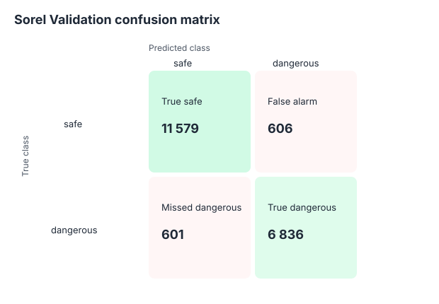

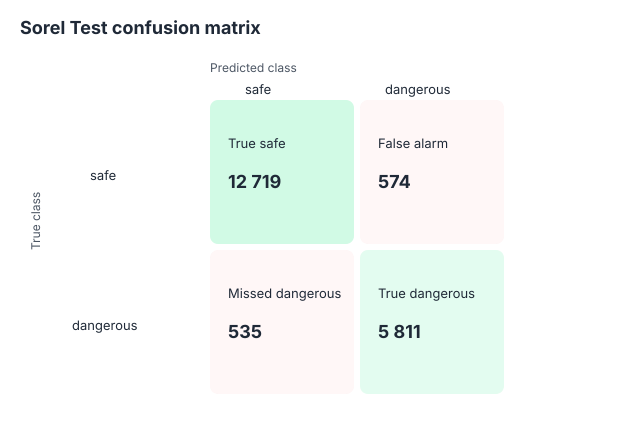

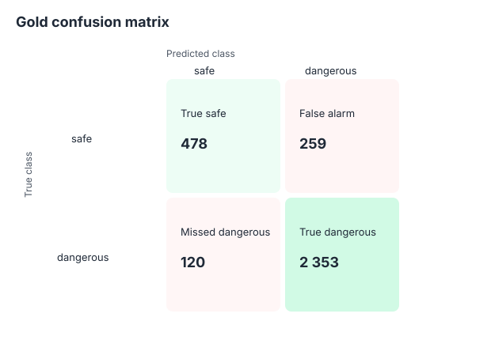

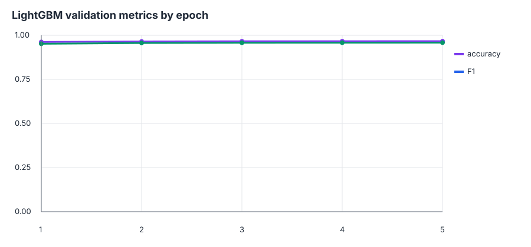

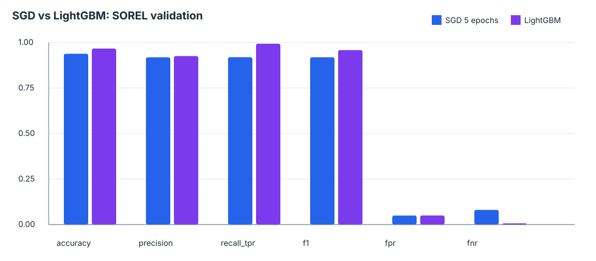

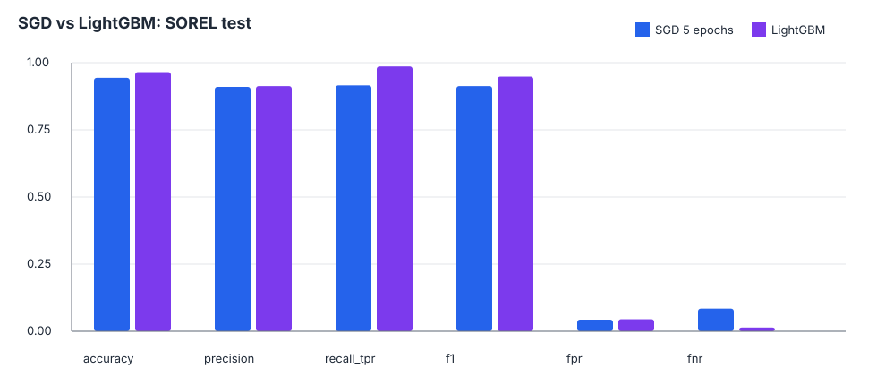

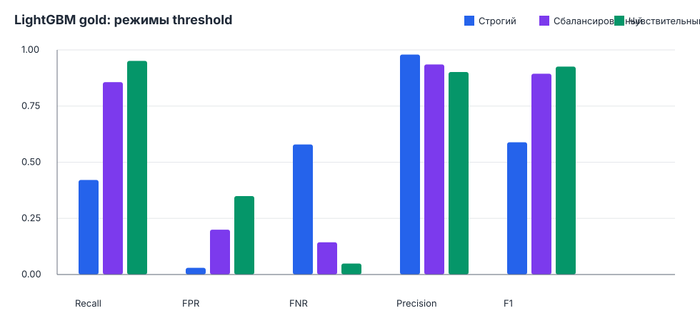

## Источники и происхождение результатов

- Размеры выборок, времена обучения, матрицы ошибок, разбор состава gold и вклады SHAP получены в экспериментах проекта. Для ранних результатов использованы журналы обучения и пакетной проверки полного корпуса. Для итогового протокола использованы сохранённые оценки на одних и тех же SHA и метрики повторных обучений.
- Richard Harang, Ethan M. Rudd. *SOREL-20M: A Large Scale Benchmark Dataset for Malicious PE Detection* (2020). Источник данных, меток и временного разбиения.
- Hyrum S. Anderson, Phil Roth. *EMBER: An Open Dataset for Training Static PE Malware Machine Learning Models* (2018). Семейство признаков статического анализа. Исторический код EMBER использован при проверке совместимости.
- MalwareBazaar, Microsoft WinGet и официальный сайт PuTTY — источники внешней коллекции. Исторические сведения о семействах и инструментах сверялись с описаниями MITRE ATT&CK (Agent Tesla, XLoader/Formbook), материалами разработчика Cobalt Strike и анализом AsyncRAT от Recorded Future.
